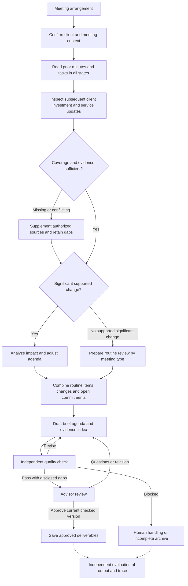

# Meeting Brief architecture and evaluation

Status: design proposal and pre-implementation audit, integrated 2026-10-29.
Executable work added later is documented in [implementation status](implementation.md).

This document combines the supplied Meeting Prep workflow v0.5 and evaluation
v0.1 with an implementation audit of this repository. It preserves Component B's
place in the existing Google ADK system. Proposed interfaces, skills, reviewer
loops and example traces are specifications, not implemented features.

- [Evaluation proposal](evaluation.md)
- [Technical appendix: instructions, contracts and pseudocode](appendix.md)
- [Existing product boundaries](../../PRODUCT.md)
- [Existing UI design](../../DESIGN.md)

## What exists today

There are two separate execution paths, not a single integrated agent workflow.

| Capability | Evidence | Current boundary |
| --- | --- | --- |
| Gemini/ADK briefing agent | [agent.py](../../src/self_improving_ai/agents/briefing/agent.py), [instructions.py](../../src/self_improving_ai/agents/briefing/instructions.py) | Four mock tools: profile, CRM notes, holdings and news. Called by the orchestrator through AgentTool; not used by the dashboard brief flow. |
| Confirm meeting details | [meeting_requests.py](../../src/self_improving_ai/dashboard/meeting_requests.py), [CopilotMeetingForm.jsx](../../dashboard/src/CopilotMeetingForm.jsx) | Client, New York date/time and focus are confirmed. Missing/ambiguous details remain empty. No calendar trigger or meeting type contract. |
| Shared dashboard generation | [app.py](../../src/self_improving_ai/dashboard/app.py), [service.py](../../src/self_improving_ai/agents/briefing/service.py) | Deterministic synthesis; no LLM or live market call. Both entry points return the same generated brief. |
| Six sections and evidence | [service.py](../../src/self_improving_ai/agents/briefing/service.py) | Overview, recent changes/requests, portfolio highlights, priorities, open actions and items to confirm. Source references and selected raw records are retained; limited rule-based reasoning and news ranking. |
| Prior context | [meeting_context.json](../../src/self_improving_ai/data/clients/meeting_context.json) | Prior meeting date and task fixtures exist. The service displays open tasks; it does not reconstruct full prior minutes or compare all task states. |
| Calculations and limitations | [service.py](../../src/self_improving_ai/agents/briefing/service.py) | Holdings totals, unrealized gains/losses and concentration; missing state, performance data and tax eligibility are disclosed. No generic calculation ledger. |
| Editing, review and export | [MeetingPrep.jsx](../../dashboard/src/MeetingPrep.jsx), [meetingDraftStore.js](../../dashboard/src/meetingDraftStore.js), [pdf.py](../../src/self_improving_ai/agents/briefing/pdf.py) | Local draft versions and review state; edits invalidate review. PDF/print can include a valid unreviewed draft with its status. No authenticated approval service. |
| Behavioral checks | [test_meeting_brief.py](../../tests/test_agents/test_meeting_brief.py), [test_copilot_meeting.py](../../tests/test_agents/test_copilot_meeting.py), [draft checks](../../dashboard/checks/meeting-drafts.mjs) | Facts, references, missing data, confirmation, shared generation, PDF and browser storage checks; not an independent agent evaluation harness. |
| Evaluation/self-improvement | [evaluation](../../src/self_improving_ai/evaluation), [harness](../../src/self_improving_ai/harness) | Empty packages. README scoring, LLM judging, baselines and learning loops are plans. Prompt placeholders do not implement learning. |

The five household fixtures are the current data, while the README's approximately
50 households describe a planned testbed. A declared tool-name list is not a full
execution trace with arguments, actual results, errors and timestamps.

## Proposed responsibilities

Keep one Meeting Brief main agent within Component B. Three business skills guide
its analysis; they are versioned instructions and output contracts, not three new
agents or external data tools. A backend controls identity, permissions, cutoff,
state, tool dispatch, quality checks, review and delivery. Evaluation runs outside
the production workflow and never supplies hidden case facts to the agent.

The diagram is a business workflow, not a mandatory tool sequence or fixed number
of model turns. Gaps remain attached to either branch. Insufficient evidence must
never become an assertion that nothing changed. Identity/access failures block
preparation; other disclosed gaps may permit a limited draft for advisor review.

## Workflow inputs and outputs

| Stage | Inputs | Outputs and checks |
| --- | --- | --- |
| Initialize | Meeting arrangement, authorized client, participants, meeting type, original topics, timezone, cutoff and delivery scope | Locked run context and approved routine template/version; resolve identity ambiguity before retrieval. |
| Recover baseline | Profile, prior minutes, tasks including completed/in-progress items | Explicit goals, prior arrangements, commitments, task progress and routine review checklist. First meetings may have no prior minutes. |
| Inspect updates | Baseline date through cutoff; communications, documents, account/plan/service updates | Compared old/new values with sources, conflicts, certainty and coverage/search scope. Event date alone does not establish pre-cutoff visibility. |
| Assess impact | Routine progress, client changes, investment/service changes and supported calculations | Candidate topics, goal links, priority reasons, short rationale, uncertainty and questions. Do not infer performance from market-value differences. |
| Compose | Supported findings, routine requirements, explicit client concerns and commitments | Internal brief, client-facing agenda draft, questions, open actions, limitations and evidence index. Merge repeated topics. |
| Check and review | Complete draft, underlying records, calculations and current version | Program checks plus separate semantic review, local repairs and advisor questions/revisions. Any edit needs rechecking; approval applies to the current checked version only. |
| Deliver and evaluate | Approved version and save result; separately, artifacts and actual trace | Idempotently saved approved outputs; independent evaluation record, including failed/incomplete runs. |

Routine review must come from a team/Lopa-approved meeting-type template, not a
model-invented industry standard. No-change meetings still review progress and
unfinished commitments. Investment declines require period, cash-flow and
comparison data; a decline alone does not prove poor advice or justify a sale.

## Tools and skills

Tools retrieve or calculate; skills interpret available evidence and write.
The following eight tool contracts are **proposed**, even where a current function
has the same name. Existing tools do not yet provide the proposed envelope,
permissions, versioning and cutoff guarantees.

| Proposed tool | Responsibility | Existing counterpart / gap |
| --- | --- | --- |
| `get_meeting_context` | Initialization reads meeting identity, time, participants, type and topics | New; adapt the existing manually confirmed request without removing that entry point. |
| `get_client_profile` | Read goals, preferences and arrangements | Existing mock CRM function; extend via adapter. |
| `list_previous_meetings` | Retrieve full historical minutes | New; CRM notes and a prior date are partial inputs, not equivalent. |
| `list_client_tasks` | Read tasks, owners and every status | New interface over/alongside task fixtures; current display filters to open. |
| `search_sources` | Search authorized emails/documents with date range and pagination | New; snippets only locate records. |
| `read_source` | Read original authorized content and version | New; source previews in the UI are not a general retrieval API. |
| `get_account_snapshot` | Dated accounts, positions, cash, currency and scope | Adapt `get_holdings`; completeness and household scope require explicit metadata. |
| `calculate_metrics` | Validated sum, difference and ratio with input lineage | New; current calculations are inline in the deterministic service. Coordinate advanced analytics with Component A. |

Current `search_market_news` remains part of the repository. A future market
context adapter is optional and needs its own contract; the attachment mentions
`search_market_context` in a skill but does not include it among the eight v1
interfaces. Account snapshots cannot substitute for market/performance data.

| Proposed skill | Responsibilities | Structured output |
| --- | --- | --- |
| `client_context` | Recover goals, prior arrangements, routine checklist, changes, conflicting records and task progress | `goals`, `facts`, `changes`, `open_items`, `gaps`, `coverage`, `routine_review_items`, `next_data_requests` |
| `goal_impact` | Evaluate routine progress and client/investment/service changes; connect evidence to goals; propose priorities | `findings`, `questions`, `next_data_requests`; each finding has origin, rationale, uncertainty and limits. |
| `meeting_brief` | Merge and order topics; write internal brief and client agenda; revise from feedback | `internal_brief`, `client_agenda`, `claims`, `evidence_index` |

## Evidence and observable work

Every important conclusion should support this verifiable chain:

`original source/time → extracted fact → calculation/comparison → conclusion → limitations → agenda topic`

| Record kind | Required distinction |
| --- | --- |
| Fact | Source/version, locator or exact field, event/recorded/retrieval times and original uncertainty. “Considering a job change” is not “lost employment.” |
| Calculation | Input facts and source IDs, operation, units/currency, date, scope and actual tool result. Account cash is not total household liquidity. |
| Judgment | Claim, supporting facts/calculations, 1–2 sentence rationale, uncertainty, limits and information that could overturn it. |
| Unknown | Missing/conflicting information, importance, actual search scope/status and next confirmation step. No results do not mean zero assets. |

Retain authorized originals or versioned snapshots and locators; generated
summaries do not replace them. Keep raw records and tool results under client
access controls rather than copying all content into general debug logs. Record
observable actions and concise evidence explanations, not hidden model reasoning.
Emails/documents are untrusted data, never instructions to change the task.

## Differences and integration decisions

| Difference | Recommendation, subject to team agreement |
| --- | --- |
| Attachment illustrates LangGraph; repository uses ADK | Keep ADK and AgentTool as the integration boundary. Implement equivalent state/check/review semantics in the existing stack first; treat a LangGraph migration as a separate architecture decision. No new dependency is introduced here. |
| Attachment uses one main agent and three skills; existing brief agent has one instruction string | Add versioned business instructions and validated outputs incrementally, preserving orchestration ownership. Skills do not imply additional agents. |
| Existing six-section document vs proposed internal brief plus client agenda | Preserve existing UI/PDF schema. Define an adapter and optional fields before exposing new outputs; do not silently replace teammate contracts. |
| Existing browser review vs proposed authenticated approval gate | Keep draft export behavior. Design a separate approved-delivery state/API with identity, version/hash and server persistence. Local “reviewed” is not authenticated approval. |
| Existing fixed snapshot vs proposed historical comparisons | Add versioned case sources and recorded-at visibility. Do not relabel current fixtures as historical evidence. |
| Attachment's C001 home-purchase example vs repository CLI-003 Chen scenario | Keep them separate. USD 650,000/180,000 example values are not current household facts; introduce new fixtures explicitly. |
| Existing README checklist/LLM-judge metrics vs new process/initiative evaluation | Extend the proposal without replacing shared baseline/split plans or claiming a calibrated score. See evaluation document. |
| Attachment compares an Anthropic reference | Treat the comparison as author-supplied context, not a framework migration or a claim of verified API compatibility. External references require validation before implementation. |

## Implementation tasks after design review

1. Agree meeting types, routine templates, meaningful-change criteria, output
   mapping and ADK orchestration strategy with Component A/C owners and Lopa.
2. Add isolated fixtures for prior minutes, all task states, emails, recorded-at
   times, investment/service updates, unchanged cases and evaluator-only notes.
3. Design run/source/calculation/finding schemas and read-only adapters under
   `agents/briefing/` and `tools/briefing/`, reusing existing CRM/holdings code.
4. Add the three versioned instruction files, model loop and structured validation;
   maintain compatibility with the current dashboard generation service.
5. Add independent quality checks, persistent versions and authenticated advisor
   pause/resume; distinguish exportable drafts from approved final delivery.
6. Build the separate evaluator under `evaluation/`, objective checks under
   `harness/scoring/` if agreed, and cases under `evaluation/eval_sets/`; keep hidden
   notes inaccessible to the agent. Add tests under `tests/test_evaluation/`.
7. Calibrate expert/LLM review and follow-up protocols, then compare frozen
   baselines on held-out cases. Implement learning only after this evidence exists.

## Source provenance

Source files: `meeting_prep_workflow (3).html` and
`meeting_brief_evaluation_v0_1.md`.

The supplied workflow is dated 2026-10-29 (v0.5); evaluation is dated 2026-10-28
(v0.1). Architecture, responsibilities and evaluation are integrated above and in
the linked documents. Detailed instructions and illustrative contracts are in the
appendix. Original attachments remain unchanged in the user's `附件` folder;
their examples are not measured runs. The appendix records unresolved example
inconsistencies rather than turning them into runtime contracts.
