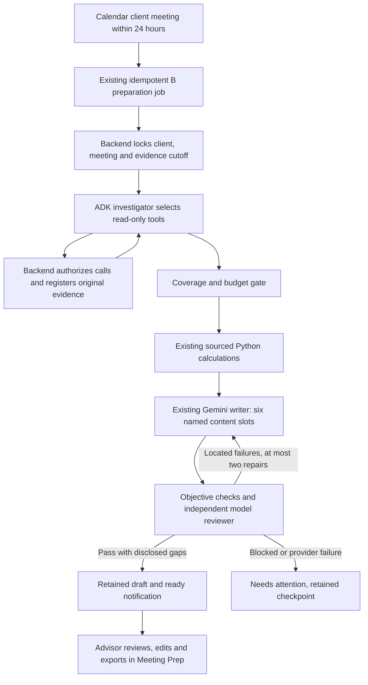

# Part B: tool-using Meeting Prep agent integration

Status: implemented and connected to AI mode, 2026-11-05. The investigator runs
before the existing ADK/Gemini writer and independent reviewer. Offline demo remains
deterministic. `SIA_BRIEFING_DISCOVERY=agent` is the AI-mode default; explicitly
select `backend` only to use the earlier collector for diagnostics. No fallback
from a failed investigator to offline/backend collection occurs.

Implementation: `agents/briefing/discovery.py` and `runtime.py`; the installed ADK
Runner exercises real tool dispatch. Completed results and budget counters are
checkpointed after each read. Retry starts a new investigator session supplied
with those exact cached results; full ADK conversation/crash-safe session replay
is not claimed. Model-selected and backend-required reads have distinct origins.

Real acceptance: direct Okafor generation passed in 13.06 seconds. A subsequent
calendar-worker acceptance produced and persisted Okafor plus the next eligible
Patel brief in 34.04 seconds total. The latter records 47,152 reported tokens
across both jobs (20,713 Okafor, 26,439 Patel), including repair/review calls.
These are public synthetic smoke cases, not a calibrated reliability or quality
benchmark. See the implementation record for artifacts and remaining checks.

## User outcome

A client meeting approaches. Preparation happens without prompting the advisor.
The advisor receives a ready notice and opens a useful, sourced brief in Meeting
Prep. A colleague's internal meeting or a lunch block does not trigger a client
brief. Existing Calendar, meeting list, review/edit/export and retained document
identity remain the product interface. No new chat box or manual agent launcher.

Example: Wednesday's Okafor home-purchase meeting. The agent reads the prior
minutes, later email, profile, account snapshot, tasks and recorded flags. It
preserves the tentative purchase date, asks about unknown external funding and
state of residence, and produces the existing six sections. It must not infer a
household cash shortfall from the managed-account value.

## Stack and ownership

Keep Python/FastAPI, Google ADK, the configured `SIA_AGENT_MODEL`, existing Gemini
request policy, SQLite job/run/draft records and React/Vite. No replacement
framework, new model provider, external Outlook or database migration is needed.
Do not modify A/C agents or reimplement their advanced portfolio calculations.
The proposal is wholly inside B's service boundary.

One business capability, Part B, has three execution stages: investigate, compose,
and independently check. These are implementation stages, not three additional
project parts and not replacements for B's three existing business skills.

## Stage 1: bounded investigation — implemented

A B-local `meeting_context_investigator` runs with function tools and no final-brief
output schema. It chooses relevant reads/searches and follows up on gaps. The
backend, not the model, defines permitted clients, cutoff, available tools and
budget. Tool results populate an evidence registry through ToolContext.state;
the agent's prose summary cannot manufacture source records or coverage.

| Tool family | Agent responsibility | Backend responsibility |
| --- | --- | --- |
| Four Briefing catalog tools | Retrieve profile/CRM, identify relevant news and recorded confirmation work | Validate inputs, enforce fixture cutoff, bind client and disclose provenance/limitations |
| Prior minutes and tasks | Recover baseline, commitments and progress | Reuse B's existing `list_previous_meetings` and `list_client_tasks` adapters |
| Source search and original read | Locate updates and read full originals | Reuse B's `search_sources` and `read_source`; enforce client and recorded-at cutoff |
| Account snapshot | Identify relevant positions and scope | Reuse the existing holdings adapter; no A code changes or inferred external balances |
| Calculator | Request only supported arithmetic | Reuse B's Decimal calculations and lineage registry; advanced A calculations stay separate |

Implementation contract:

- Scoped wrappers are implemented around the public fixture tools. Model arguments may
  not select another client or later cutoff; bind these from the confirmed job.
- AI investigation uses a separate result-driven registry and does not call the
  full `prepare_context` collector first. The earlier collector remains the explicit
  backend strategy and continues serving the deterministic path.
- A baseline gate requires profile, account scope, prior minutes/search status,
  tasks and recorded compliance follow-ups. Mandatory reads can be enforced if
  skipped; mark those events `backend_required`, not model-selected.
- News is optional and relevance must be supported by holdings, goals or meeting
  focus. Synthetic regulation articles never establish client-specific rules.
- Search snippets locate records; only full, authorized originals are citable.
- Preserve no-results, incomplete history, conflicting records and tentative
  wording. Missing information can produce a bounded draft with explicit questions;
  identity/access failure blocks preparation.
- Store actual tool names, arguments, results, origin, source IDs, date/version,
  call count, usage and elapsed time. Do not store private reasoning.

Enforced budgets: four investigator model turns, ten tool executions and eighteen
tool requests per run, with at most one optional news search, with exact duplicate reads served from the run snapshot. Reject excess
calls and return explicit coverage gaps. Bound model output to a short discovery
summary; the writer receives originals, not a giant model transcript. Reuse
existing provider timeouts/retries and never turn credential/quota errors into
blind retries. Budget values require acceptance measurement before being called
performance targets.

## Stages 2 and 3 — reuse the working path

The writer continues receiving authorized originals and verified calculations,
with `tools=[]`, native structured content output and strict local validation.
Python owns six-section order, titles, IDs and citations. This separates optional
tool exploration from the established structured-output call; it is an engineering
choice for this integration, not a claim that ADK universally forbids using tools
with structured output.

Retain objective checks, the independent Gemini reviewer, at most two repair
cycles, checkpoint/resume and current human review/version rules. Compliance
confirmation tasks must be included where relevant, with original references;
no flag means no recorded flag in scope, not regulatory clearance.

A draft becomes Ready only after the checks pass. Reviewed remains a separate
advisor action; edits invalidate it. A 503 keeps the job in Needs attention with
its actual saved phase; explicit retry resumes safely rather than pretending an
offline brief was an AI success.

## Service and state contract

Retain `POST /api/meeting-preparations/events/{id}`, the calendar worker and
`create_meeting_brief` as entry points. Investigation runs inside
`generate_agent_brief`, before the existing preflight/writer. Persisted run phases:
`discover -> generate -> review -> complete`; sourced calculation is an idempotent preflight before generation.

Include discovery strategy/version in the interrupted-run fingerprint. Save
completed source registrations after each read and checkpoint the investigator's
observable conversation state if retrying it is necessary. Do not claim the
existing in-memory ADK session already provides crash-safe turn resumption.
Register-only-completed calls prevent half-read records from becoming evidence.
Calendar event/version/mode idempotence still selects one retained job/document.

The current API may continue exposing Preparing during discovery/generation;
user-facing detail can later show concise Collecting context / Preparing brief /
Checking brief states only when backed by persisted phase data. Do not put tool
names and orchestration graphs into the default advisor flow.

## Completed rollout and next validation

1. Completed: four catalog tools, session-scoped wrappers, cutoff/source registry,
   investigator integration, budgets and incremental read checkpoints.
2. Completed: default AI discovery strategy, versioned interrupted-run fingerprint,
   and calendar cache invalidation for earlier AI pipelines. Historical draft
   records stay intact; outdated AI job links are replaced when that event is prepared.
3. Completed: offline dispatch, full writer/reviewer integration, client/cutoff
   rejection, cached-read retry and real Gemini calendar acceptance.
4. Next: inspect the real briefs with the teammate, then run Thompson's unchanged
   case, Chen's incomplete-history case and Garcia's education-funding case.
5. Next: calibrate usefulness, omissions and preparation length with the employer,
   measure repeated-run latency/quota and freeze the MVP presentation scenario.

Acceptance requires valid sources/IDs, no invented calculations or clearance,
correct tentative wording, explicit unknown external balances, no unrelated news,
no repeated tool loops, and the same retained brief accessible from Calendar and
Meeting Prep. A single passing real run is smoke-test evidence, not a reliability
claim. Real acceptance records retain actual tool origins, model usage and final review results.

## Technical references

The installed SDK's FunctionTool declarations and offline Runner test are the
compatibility evidence for this repo. Official ADK documentation explains Python
function tools and server-provided ToolContext, and callbacks for checking or
recording tool execution:

- [Function tools](https://github.com/google/adk-docs/blob/main/docs/tools-custom/function-tools.md)
- [Callback types](https://github.com/google/adk-docs/blob/main/docs/callbacks/types-of-callbacks.md)
