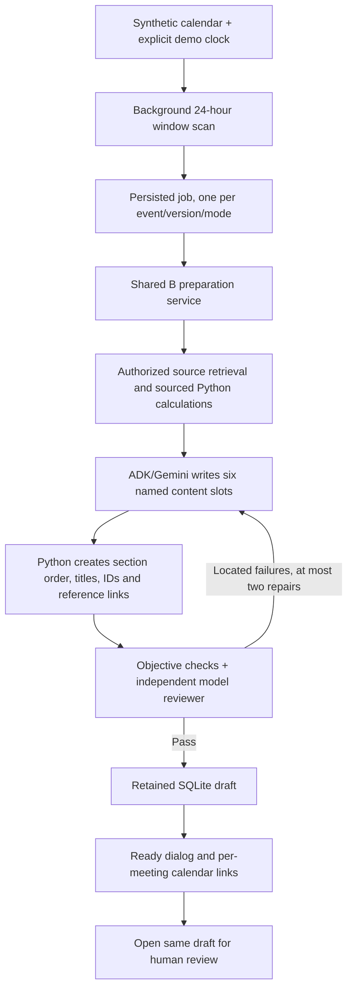

# Calendar-triggered meeting preparation

## Advisor workflow

**Calendar** is the schedule. **Meeting Prep** is the place to review preparations.
Both open the same retained brief and restore local edits and review state by ID.
This change is confined to Part B; it does not implement new portfolio or
orchestration behavior, external mailbox/calendar connections, or a new database.

The fixture contains 35 events across adjacent weeks, including 12 client meetings
for the five existing households. The current Monday–Friday week includes client
reviews and follow-ups, team meetings, morning planning, lunch and service work.
Locations, attendees, durations and event descriptions are synthetic calendar data.
Only client meetings can create preparation jobs; internal/focus/personal events
show a clear no-client-brief explanation.

1. Open Calendar. The demo clock is Tuesday, November 10, 2026 at noon New York.
   A next-client-meeting strip highlights Garcia's 2 PM follow-up and its status.
   The calendar initially scrolls near the relevant time; Today and week arrows work.
2. The background worker automatically prepares Garcia and Wednesday morning's
   Okafor meeting inside the 24-hour window. Default mode is Offline demo.
3. One client-specific ready dialog appears per page visit. View meeting prep opens
   the retained brief; Later, Escape and Close acknowledge the notice. Further
   ready items remain available in the topbar notification or preparation list.
4. Calendar appointment details show when, where and who. Each client event also
   has a direct preparation button; this may prepare it early when necessary.
5. Meeting Prep opens a dated list rather than a generation form. Search client or
   meeting topic; choose Upcoming or This week. States reflect actual jobs and the
   current browser's review record. Desktop shows list and brief side by side;
   mobile uses list-to-detail navigation with All meetings.
6. A selected ready brief leads with At a glance (existing focus and priority titles),
   followed by six sections, evidence, editing, checks, review and exports. Review
   changes update list/count/detail immediately; editing invalidates review.
7. Selecting a future scheduled meeting from the list explains automatic preparation
   and offers Prepare early. Merely inspecting it does not generate a brief. Prepare
   another meeting retains the optional manual form. Copilot/client-detail entry
   remains compatible with the same existing Part B service.

**Demo settings** retains mode, pause/resume, advance one day, reset and ready-notice
replay. Reset clears calendar job links, keeps draft/review records and enables
Offline mode. Replay uses an existing ready brief without another model call.
Selecting AI Agent · Gemini pauses automatic scanning; Resume automatic prep enables
that mode and uses configured API quota. Explicit calendar preparation in AI mode
also uses quota when no retained brief exists.

## Architecture

The content contract removes model-created graph IDs and uses one atomic sourced
claim per content item. The writer receives prepared evidence and metrics, without
execution logs or unnecessary tools. Native structured output uses a portable
GenerateContent schema subset; strict Pydantic validation remains at the backend.
The normal path is writing plus review; repairs are explicit and bounded.

Calendar work uses the same `create_meeting_brief` boundary as Copilot and Meeting
Prep, including persistence, error classification and quality checks. Background
execution is serial. Failed jobs remain **Needs attention** and do not retry on
every scan. A deliberate **Retry preparation** reuses identical inputs and B's
retained interrupted checkpoint when the model, cutoff and contract version match.

## Data and APIs

- Calendar fixture: `src/self_improving_ai/data/calendar/events.json`.
- `GET /api/calendar`: demo clock, event definitions and preparation states.
- `POST /api/calendar/simulation`: start, pause, advance by 24 hours or reset.
- `POST /api/calendar/preparations/{id}/retry`: explicitly retry a failed job, including while monitoring is paused.
- `POST /api/calendar/events/{id}/preparation`: idempotently open or queue that event in the current mode.
- `GET /api/calendar/preparations/{id}/brief`: retrieve the same ready draft.
- SQLite tables: `calendar_simulation`, `calendar_preparations`, plus existing
  `meeting_runs`, `meeting_drafts` and `meeting_reviews`.

This is a single-process local MVP with synthetic calendar and CRM/email records,
not Gmail, Google Calendar or Outlook synchronization. The backend must remain
running. Pausing stops new jobs without cancelling a currently running preparation.
There is no client delivery, trading, CRM write or automatic advisor approval.
Fixture evidence remains dated through its disclosed cutoff, rather than becoming
live data because a later meeting is on the simulated calendar.

## Verification

The offline suite checks named slots/IDs/references, source constraints, SDK schema
compatibility, review/resume, calendar time-window filtering, idempotence,
concurrent scans, failure visibility and absence of automatic retry flooding.
Desktop/mobile browser checks cover the default work week, automatic ready dialog,
opening the same six-section brief without a manual generation form, internal-event
exclusion, queue search, review-state synchronization, early preparation and adjacent-week navigation.
Backend tests additionally cover clock advancement, explicit preparation while paused
and retry after a provider failure.

Real acceptance: Okafor, Gemini 3.5 Flash-Lite, **29.25 seconds**, one repair,
**12,786 recorded tokens**, all objective and independent-review checks passed.
The result was manually inspected for tentative wording and unknown external
funding. This is a public synthetic smoke test, not expert certification or proof
that provider 503 errors have been eliminated.
