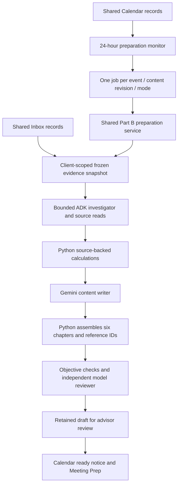

# Shared Calendar, Inbox and meeting preparation

## Current integration

The teammate's PR #4 (`4316af3` on main) supplies the canonical monthly Calendar,
Calendar CRUD, simulated Inbox and Firestore document schemas. Part B now consumes
those records. The earlier private weekly calendar component, event dialog and
35-event JSON fixture have been removed. There is one schedule and one Inbox.

Calendar remains the schedule; Meeting Prep remains the brief review workspace.
Both open the same retained draft. Calendar editing and Inbox operations keep the
teammate's layout and theme. Part A/C model and portfolio changes from main remain
in place.

## Demo workflow

1. Open Calendar. The explicit demo clock starts November 11, 2026 at 3 PM New York.
   The shared seed has nine client meetings across October–December, five in
   November. Garcia's November 12 review is within the 24-hour window.
2. The serial background monitor automatically prepares Garcia in Offline demo
   mode. One ready notice appears per page visit and opens the retained brief.
   Later, Escape and Close acknowledge it; further notices remain in the topbar.
3. Each calendar event offers Meeting prep. This queues preparation early when
   necessary. The event editor continues to support create/edit/delete.
4. Meeting Prep lists upcoming meetings with search and status. Ready briefs offer
   At a glance, six sections, evidence, editing, checks, review and exports. Future
   meetings explain the automatic window and offer Prepare early. The optional
   Prepare another meeting form stays inside this workspace.
5. Inbox shows the teammate's simulated correspondence. Linked messages become
   discoverable original sources for the same client. For example, Okafor's
   November 5 email raises a possible mid-December down-payment deadline, which
   must remain tentative rather than replace confirmed account facts.
6. Demo settings changes preparation mode, pauses/resumes, advances one day,
   resets preparation jobs or replays an existing ready notice. Reset preserves
   Calendar/Inbox edits and retained drafts. Selecting AI mode uses configured
   Gemini quota if automatic preparation is enabled.

## Storage configuration

`SIA_WORKSPACE_STORE=local` is the default. It stores the teammate's exact document
schemas and seed records in the configured SQLite database. It needs no cloud
credentials and persists Calendar/Inbox edits across restarts. It is a local
adapter for the shared records, not a second calendar fixture or cloud replica.
No local/cloud synchronization is implemented.

To use the team's existing Firestore database, install project dependencies,
set `SIA_WORKSPACE_STORE=firestore` and `SIA_GOOGLE_CLOUD_PROJECT` to the team's
project, then configure Application Default Credentials with access to that
project. `GOOGLE_APPLICATION_CREDENTIALS` can point to a locally managed credential
file. Credentials stay outside Git. A Gemini API key alone does not authenticate
Firestore. The preserved stores use `calendar_events` and `emails` collections and
seed an empty collection with synthetic records when initialized.

Firestore is resolved lazily. An explicitly selected but unavailable Firestore
backend returns a safe 503; it never silently switches to unrelated local data.
Firestore snapshots are cached for up to five seconds and invalidated by local
CRUD writes. Changes from another computer become visible after the cache expires.
Real Firestore credentials and connectivity have not been verified on this machine.

Preparation jobs, AI checkpoints and draft/review records remain in local SQLite
in either mode. This is a single-backend-process MVP; the backend must stay running.

## Architecture

Offline mode runs deterministic content assembly and actual Python calculations;
it does not claim to be model reviewed. AI mode uses the existing ADK/Gemini
investigator, writer and reviewer pipeline. Typed provider 503 errors can try the
configured alternative Gemini model; actual model provenance is retained. Failed
jobs remain visible and require explicit retry. No automatic advisor approval,
external email delivery or trading is performed.

## Evidence and invalidation

The server freezes client-linked Inbox/Sent/Archive messages at the earlier of the
demo day and meeting day. Drafts, global/internal messages without a client link,
other clients, future messages and later-ingested backdated messages are excluded.
Search snippets must be followed by original reads before citation. Existing
minutes, task and CRM fixtures remain available. A past scheduled event does not
establish that a meeting happened or replace prior completed minutes.

Mail subjects, participants, body, date and time contribute to context revision.
New/deleted/changed correspondence or changed meeting details invalidate the
calendar's old job link and AI resume fingerprint. Read/star/archive operations
do not change the content revision. A meeting changed during generation cannot
publish an old ready notice. Historical drafts remain retained separately.

The operational cutoff does not refresh the dated holdings snapshot. Seed emails
contain reported estimates and account labels that can conflict with the portfolio
fixtures. The writer must flag those differences and ask for confirmation, rather
than treating correspondence as verified balances, calculations or legal rules.
Team policy checks return review triggers with partial coverage, not clearance.

## APIs

| Purpose | Endpoint |
| --- | --- |
| Shared Calendar CRUD | `/api/calendar/events` and `/api/calendar/events/{id}` |
| Shared Inbox CRUD | `/api/email/messages` and `/api/email/messages/{id}` |
| Clock, current events and preparation states | `GET /api/meeting-preparations` |
| Demo controls | `POST /api/meeting-preparations/simulation` |
| Open or queue current event preparation | `POST /api/meeting-preparations/events/{id}` |
| Explicit failed-job retry | `POST /api/meeting-preparations/{job_id}/retry` |
| Retrieve the current retained ready draft | `GET /api/meeting-preparations/{job_id}/brief` |

Calendar dates/times and linked clients are validated before persistence. UI CRUD
failures stay visible rather than closing forms and pretending a write succeeded.

## Verification

Offline backend tests cover the original B contracts, shared Calendar CRUD,
client/cutoff isolation, mail snapshot freezing, content invalidation, deletion and
rescheduling during generation, explicit cloud outages and model fallback.
Browser checks cover the monthly Calendar, automatic ready dialog, six-section
review at desktop/mobile widths, meeting creation validation, Inbox archive/read
operations and retained manual/Copilot preparation.

Earlier live acceptance reports describe the previous private fixture. They are
historical evidence, not proof of the new Firestore integration. The updated
`scripts/audit_calendar_briefing.py` exercises the canonical Okafor event through
the same operational scope; pass `--live` with an isolated `SIA_DB_PATH` to opt in.
