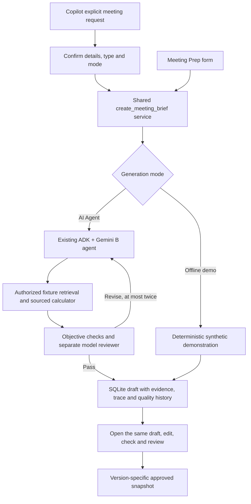

# Part B integration verification — updated 2026-11-07

Branch: `codex/proactive-meeting-prep`, integrating main `4316af3` (PR #4).

## Shared Calendar/Inbox integration (2026-11-07)

The teammate's PR #4/main changes have been integrated with Part B. The private
weekly calendar fixture/UI is removed; shared Calendar/Inbox CRUD supplies the
preparation monitor and client-scoped evidence. Original portfolio and C changes
from main are preserved.

- Offline Python suite: **269 passed, 78 subtests passed**; network connections
  were blocked by the verification runner.
- Chrome integration: **10 passed**, covering desktop/mobile calendar notices,
  six-section review, Calendar creation/validation, Inbox read/archive, retained
  manual form and Copilot handoff.
- Vite production build passed.
- Real Firestore credentials/connectivity have **not** been verified locally.
- One explicitly authorized live Okafor audit passed **16/16 technical checks**
  with `gemini-3.5-flash-lite`: **9.35 seconds**, **19,167 recorded tokens**, one
  quality round and no alternative-model invocation. These are trace-recorded
  tokens for the retained brief, not a billing statement.
- The investigator read the canonical Inbox original `EML-a3b4c5d6`; its content
  reached the writer and citations. Six sections, actual calculations, objective
  and independent model checks, persisted draft and retained reopening passed.
- Manual inspection found a content-quality limitation despite the automated
  pass: the change summary compresses an older tentative six-month purchase plan
  and the newer possible mid-December down-payment deadline into one sentence.
  It should attribute these updates chronologically, distinguish purchase dates
  from payment deadlines, and explicitly ask which dates remain current. The
  simulated sender name also differs from the primary-contact profile and needs
  clarification. This case is technical integration evidence, not full editorial
  or financial acceptance.

The live command used an isolated local SQLite database and fixture news, with
no Firestore access. Full local receipt: `/private/tmp/sia-workspace-live-approved-20261107.json`.
Runtime receipts are not committed. No second live case was run. Earlier receipts
below concern the superseded private calendar fixture.

See [current workflow and configuration](calendar-simulation.md). No employer
approval, live cloud-database verification or quality guarantee is implied.

## Historical acceptance: content-v2 and calendar trigger

The real Okafor calendar-triggered case **passed** with Gemini 3.5 Flash-Lite in
**29.25 seconds**, recording **12,786 tokens** across writing, one targeted repair,
and independent review. Source retrieval, the actual Decimal calculator, all six
sections, valid links, scoped change status and separate reviewer usage passed.
The initial draft's two incomplete judgment boundaries were rejected and repaired.
The final draft retains the tentative purchase date and expected down payment;
external savings remain unknown rather than an asserted household shortfall.

The simulator supplied client, date/time, meeting type and focus without a manual
brief request. The ready notification links to the stored draft; it is not an
advisor approval or a sent client message. The worker was paused after acceptance.
The full artifact is retained locally in the ignored
`artifacts/briefing/calendar-live-acceptance.json`.

One bounded repeat through the direct B entry point later encountered a provider
503 after 19.14 seconds, with 3,548 recorded tokens. Its checkpoint and diagnostics
were retained (`artifacts/briefing/content-v2-repeat.json`). The successful calendar
case is a complete acceptance pass, not evidence that every repeat is available.
The final offline suite passed **229 tests and 78 subtests**. Six desktop/mobile
browser workflow checks passed, including the cross-page calendar notification;
the production dashboard build passed.

The earlier failed runs below are historical evidence, not the current acceptance
status. Provider capacity errors can still occur. See
[calendar simulation](calendar-simulation.md) for the current architecture and demo.

## Changes

- Restored the missing async runtime import used by generation, checking and review.
- Restored the narrow Copilot meeting-preparation confirmation handoff. Both UI
  entry points now select meeting type and Offline demo / Gemini mode and call
  the same generation service. Other chat requests still invoke C's live ADK runner.
- Agent output is normalized into the UI's six-section order. Empty sections fail
  validation and enter the existing bounded repair loop.
- Review rejects changes to meeting type, timezone or generation mode as well as
  client/date/time/focus. Server-retained evidence and revision checks remain the
  source of truth. Rechecking an agent draft retains reviewer events in its report.
- The opt-in live audit records actual model/tool events, public fixture checks,
  repair results and usage. Collected events survive a failed generation attempt
  in this CLI audit; this does not add durable failed-run persistence to the API.

## Flow



The reviewer is a separate invocation using the shared B/C model setting; this is
not a different provider or a claim of independent human validation. Raw ADK
delegation outside this HTTP flow remains an unapproved agent work product.

## Completed verification

- Python suite: **213 passed, 75 subtests passed**, using an audit hook that blocks
  network connections and an isolated SQLite database. This includes provider
  failures/timeouts, no silent fallback, rejected quality, stale approval,
  server-retained evidence, section order and the two-repair limit.
- Browser suite: **4 passed** in installed Chrome. Covers Meeting Prep generation,
  checking/review/edit invalidation, no-change routine review and Copilot handoff
  at 1280px and 390px. Opening the Copilot brief produces no second generation.
- Dashboard production build: passed.
- Initial live provider verification was incomplete; the content-v2 acceptance
  above subsequently passed the complete generation and independent review flow.

Test environment: Python 3.12, google-adk 2.13.0, google-genai 2.34.0,
FastAPI 0.141.1, Starlette 0.52.1. Browser test command:

```bash
PLAYWRIGHT_CHANNEL=chrome SIA_DB_PATH=/tmp/part-b-browser.db npx playwright test tests/meeting-workflow.spec.js --workers=1
```

## Earlier live results, before content-v2

All attempts used the public `changed` fixture. No Offline demo fallback was used.

| Model | Result | Recorded model tokens | Elapsed |
| --- | --- | --- | --- |
| Gemini 2.5 Flash | HTTP 404: unavailable to this new account | 0 | 0.89s |
| Gemini 3.5 Flash-Lite | HTTP 503: provider capacity interruption after tool calls | 19,354 | 49.36s |
| Gemini 3.5 Flash-Lite, one retry | Draft returned; objective checks rejected an unread-source reference and missing agenda rationale/question; provider 503 interrupted repair | 48,163 | 32.42s |
| Gemini 3.8 Flash | 180-second timeout before any model event was recorded | 0 recorded | 180.02s |

The credential is accepted for real generation. A sourced calculation returned
`32000` USD for the managed-account snapshot. This is not a verified household
liquidity balance. No complete draft passed objective plus independent semantic
review. Zero recorded usage on a timeout is not proof of zero billed usage.

Full traces are retained locally under the ignored `artifacts/briefing/` directory.
Credential values were checked for absence in these reports/logs. The local shared
model override is restored to `gemini-3.5-flash-lite`, matching A's default. Repository
model defaults are unchanged. The B generation endpoint now distinguishes provider
503 capacity errors, 429 quota errors and unavailable-model errors from credentials.
The 27 targeted B/API tests and 19 subtests passed after this error-handling change.
The preview backend was restarted and both backend/proxy health endpoints report
`gemini-3.5-flash-lite`; health checks do not invoke the model.

## Reliability repair follow-up

See [the repair record](reliability-fixes.md) for root causes and implementation.
Final offline verification is **222 passed, 78 subtests passed** with network
connections blocked; the four browser workflow tests passed. The provider retry
test exercises the real ADK/Google SDK with a local HTTP transport, not a live model.

An intermediate real run generated a draft and passed the earlier checks in
17.56 seconds, but acceptance correctly rejected it for not executing a calculator.
Manual inspection found lost tentative language despite that earlier reviewer pass.
The final implementation adds sourced preflight totals and explicit reviewer
comparisons for modality and funding scope; do not use that intermediate result
as proof of the final implementation's live acceptance.

The final real HTTP check ran through Vite and FastAPI. The first attempt returned
503 after 72.17 seconds; identical inputs resumed the same retained run and then
returned 504 after 92.67 seconds. One actual Decimal calculation, the latest draft,
and blocking quality feedback remained stored. The retained draft needs repair
for duplicate/missing section IDs and an unresolved claim reference; it was never
delivered as a successful brief or approved. Original reference and agenda fields
are generation-constrained; remaining graph/section checks continue to block
invalid output. No complete live acceptance pass is claimed.

The run ID is `e2da3902-8810-4df0-a008-33cb4ce9540f`. Its local diagnostic record is
available at `/api/briefings/runs/{run_id}` on the running preview. Failed progress
is resumable with the same meeting inputs, model and cutoff. The final attempt and
trace are saved in the ignored `artifacts/briefing/fixed-live-http.json` and local
SQLite preview database. No further live attempts were made after this bounded
recovery check. Provider availability remains a separate limitation.

## Next verification

Configure the ignored root `.env` with `GOOGLE_API_KEY` and
`GOOGLE_GENAI_USE_VERTEXAI=FALSE`. Keep the same `SIA_AGENT_MODEL` as the team.
Run from the repository root:

```bash
python scripts/audit_live_briefing.py --live --case changed
```

Retry once the provider is available, inspect the saved trace and resolve any
remaining quality findings. Only after a complete `changed` pass, run the
`unchanged` and `missing_history` cases and review text against original sources.
Those two cases have not been attempted live. The command consumes Gemini quota.
Local/scripted tests establish integration behavior only.

Calendar/inbox simulation, scheduled triggers, notifications and authenticated
delivery are later work. A future trigger should supply a confirmed
`MeetingBriefRequest` to the shared generation boundary and use its retained draft;
it should not deliver raw orchestrator text as an approved brief.
